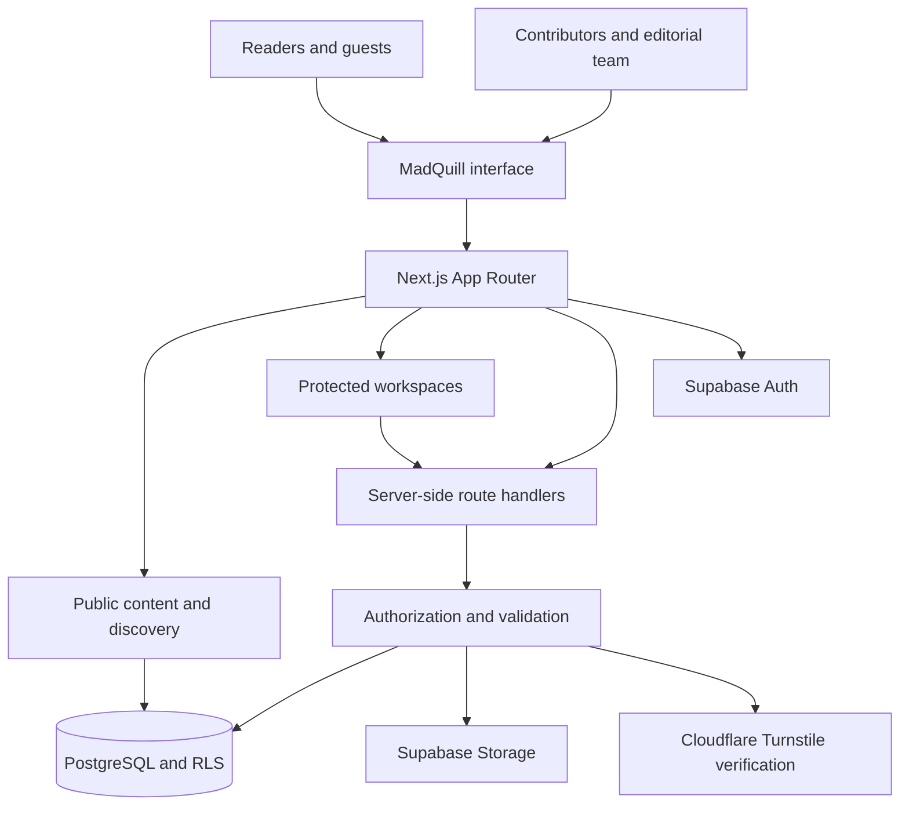
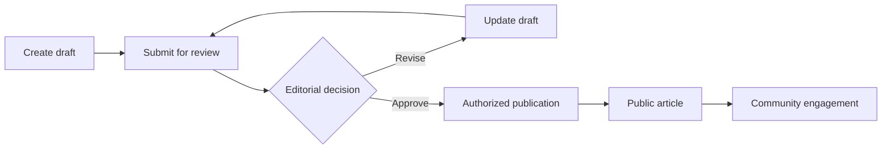
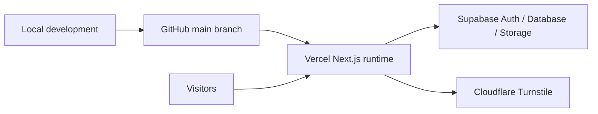

<div align="center">
  
  <h1>MadQuill</h1>
  <p><strong>Knowledge for a safer digital world.</strong></p>
  <p>An independent, community-driven publishing platform for cybersecurity, technology and research.</p>
  
  
  
  
  
  
  <br/><br/>
  <a href="#features">Features</a> · <a href="#architecture">Architecture</a> · <a href="#getting-started">Getting started</a> · <a href="#deployment">Deployment</a> · <a href="#contributors">Contributors</a>
</div>

---

## Overview

MadQuill is a full-stack technical publication that brings readers, technical writers and editorial teams together. It is designed for students, developers, security practitioners and curious learners who want to discover reliable technical content and share practical knowledge responsibly.

The project evolved from an initial blogging application into a database-backed publishing platform with controlled editorial workflows, community engagement, role-based access and a custom reading experience. Its engineering priorities are maintainability, usability, responsible security education and separation of public and privileged operations.

## Interface preview


*MadQuill-branded interface during development, before the final spacing refinements.*

<details>
<summary>Earlier homepage design — development history</summary>


*The original CipherBrief-branded homepage before the MadQuill rebrand. This is a historical screenshot, not the current production interface.*

</details>

## Features

| Area | Capabilities |
| :--- | :--- |
| Content discovery | Search, featured and trending stories, categories, tags and author directories |
| Reading | Dedicated article pages, structured technical content, code and media presentation, reading preferences and focus-oriented controls |
| Community | Likes, comments, bookmarks, reading history and supported guest interactions |
| Contributor workspace | Article creation, drafts, cover images, editing, submission and status tracking |
| Editorial workflow | Review, revision, approval and authorized publication |
| Administration | Comment moderation, featured content, contributor management and platform settings |
| Accounts | Registration, sign-in, password recovery, profiles and protected account routes |
| Interface | Responsive navigation, light/dark themes, liquid glass cards, digital rain and subtle motion |
| Discoverability | Page metadata, Open Graph imagery, sitemap and robots configuration |

## Architecture

The Next.js App Router combines public pages, authenticated workspaces and server-side route handlers. Supabase provides authentication, PostgreSQL and storage; Cloudflare Turnstile supports verified guest interactions. The application uses dynamic server rendering for data-dependent routes and static rendering where appropriate.



### Editorial lifecycle



### Access model

| Role | Intended responsibilities |
| :--- | :--- |
| Guest | Browse published content and use supported verified interactions |
| Reader | Manage personal reading activity and participate in discussions |
| Contributor | Create and manage drafts; submit articles for review |
| Editor | Review content and perform permitted editorial actions |
| Administrator / owner | Perform authorized platform, moderation and publishing operations |

Actual privileges depend on server-side authorization and database policies, not merely interface visibility.

## Technology stack

| Layer | Technology |
| :--- | :--- |
| Application | Next.js, React, JavaScript |
| Styling | Custom CSS, responsive design and motion effects |
| Runtime | Node.js, npm |
| Data | Supabase, PostgreSQL, SQL migrations |
| Identity and media | Supabase Auth and Storage |
| Abuse mitigation | Cloudflare Turnstile and signed interaction cookies |
| Quality and delivery | ESLint, Git, GitHub, Vercel (deployment target) |

## Security and privacy

MadQuill is designed with layered security controls rather than relying solely on client-side access restrictions.

- Server-side authorization for protected operations and separation of reader, contributor and administrative responsibilities.
- Database Row-Level Security (RLS) policies and controlled access to application resources.
- Supabase session management and password recovery workflows.
- Turnstile verification and signed interaction cookies for supported guest actions.
- Controlled article media handling and editorial moderation.
- Separation of public configuration from private server credentials.
- Dependency auditing and production build validation.

These controls require correct deployment configuration and ongoing testing. A successful build or dependency audit does not constitute a complete security audit. See [security documentation](docs/SECURITY.md) and [community documentation](docs/DISCOVERY-COMMUNITY.md).

## Repository structure

```text
Blog-Site/
├── public/branding/       # MadQuill logo and emblem
├── src/
│   ├── app/               # App Router pages, API routes and metadata
│   ├── components/        # Public UI, article editor, auth and portals
│   ├── lib/               # Content, authorization, SEO and backend helpers
│   └── proxy.js           # Request-level application integration
├── supabase/migrations/   # Versioned database changes
├── scripts/               # Local preview tooling
├── docs/                  # Security, community and README assets
├── .env.example           # Environment configuration template
├── next.config.mjs
├── package.json
└── README.md
```

## Getting started

### Requirements

A Node.js version compatible with the repository's dependencies, npm, Git, a Supabase project and a Turnstile configuration for verified guest interactions.

```bash
git clone https://github.com/0xDeathChief/Blog-Site.git
cd Blog-Site
npm ci
```

Copy `.env.example` to `.env.local` (PowerShell):

```powershell
Copy-Item .env.example .env.local
```

On Linux or macOS, use `cp .env.example .env.local`.

### Environment configuration

Fill in the template with your own project configuration. Never commit real secrets.

| Variable | Purpose | Scope |
| :--- | :--- | :--- |
| `NEXT_PUBLIC_SITE_URL` | Local or deployed base URL | Public |
| `NEXT_PUBLIC_CONTACT_EMAIL` | Publication contact address | Public |
| `NEXT_PUBLIC_SUPABASE_URL` | Supabase project URL | Public |
| `NEXT_PUBLIC_SUPABASE_PUBLISHABLE_KEY` | Client publishable key | Public |
| `SUPABASE_SECRET_KEY` | Privileged server credential | Private |
| `NEXT_PUBLIC_TURNSTILE_SITE_KEY` | Turnstile widget key | Public |
| `TURNSTILE_SECRET_KEY` | Server verification credential | Private |
| `CB_INTERACTION_SECRET` | Independent interaction signing secret | Private |
| `APP_MODE` | Application runtime mode; follow repository configuration | Server |

`NODE_ENV` is normally managed by the framework. Generate an independent signing secret locally using:

```bash
node -e "console.log(require('crypto').randomBytes(32).toString('base64'))"
```

### Backend setup

1. Configure the Supabase project and required authentication settings.
2. Review and apply pending migrations in `supabase/migrations/` in chronological order, including the community publishing and discovery migrations.
3. Configure storage and access policies; verify RLS and assign administrative roles through authorized operations.
4. Set the appropriate authentication redirect URLs and Turnstile hostnames.

Do not reset an existing database or blindly reapply migrations. Keep private keys outside version control.

```bash
npm run dev
```

Open [http://localhost:3000](http://localhost:3000). See [LOCAL-PREVIEW.md](LOCAL-PREVIEW.md) for additional preview instructions.

### Development checks

```bash
npm run lint
npm run build
npm audit
```

## Deployment

MadQuill targets Vercel as a dynamic Next.js application, not a static-only export.



Import the repository in Vercel, select Next.js, leave framework build/output defaults and configure the production environment variables. Set the real deployment URL in `NEXT_PUBLIC_SITE_URL`, configure Supabase redirects and Turnstile hostnames, and verify pending database migrations before launch.

### Release verification

- [x] Local production build passed during final polishing.
- [x] Dependency audit reported zero known vulnerabilities at that validation stage.
- [ ] Verify production registration, sign-in and password recovery.
- [ ] Verify database policies, editorial permissions and guest interaction protection.
- [ ] Verify publishing, comments, media, search and responsive layouts on the deployed site.
- [ ] Confirm production metadata and social sharing.

Production deployment and end-to-end verification are not asserted by this README.

## Development journey

The project began with a foundational blogging website and expanded through iterative development into MadQuill. Subsequent work introduced structured publishing, community functionality, backend and security improvements, a new editorial design system, custom branding, responsive layout refinements and production preparation.

## Contributors

| Contributor | Areas of contribution |
| :--- | :--- |
| **[Takbir Rahman](https://github.com/kaal001)** | Led subsequent platform development and feature expansion, full-stack integration, database and authorization improvements, community and editorial workflows, security controls, UI/UX engineering, branding and deployment preparation. |
| **Azmain** | Established the initial blogging application structure and foundational implementation, providing the starting point for the platform's subsequent evolution. |

Both contributors helped shape the project through complementary stages of development.

## Contributing and responsible use

Focused improvements and constructive feedback are welcome subject to repository access and maintainer approval. Use a dedicated branch, preserve authorization and database controls, run lint/build checks and document meaningful changes before submitting a pull request.

MadQuill supports educational research and ethical cybersecurity learning. Security techniques should be practiced only in authorized environments. Report suspected vulnerabilities privately to the maintainers rather than publishing sensitive details.

## License

No license is granted by this README. Refer to any license included in the repository or obtain permission from the maintainers before reuse or redistribution. Third-party dependencies retain their respective licenses.

---

<div align="center">
  
  <p><strong>MadQuill</strong><br/>Explore knowledge. Share insights. Build a safer digital world.</p>
  <sub>Developed by Takbir Rahman and Azmain.</sub>
</div>
