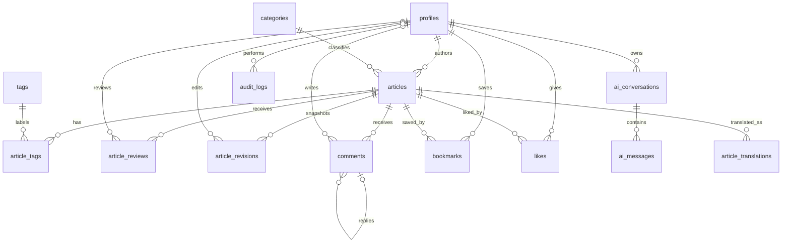

# CipherBrief

A cybersecurity publication and learning-community project, built with the Next.js App Router.

## Stack

- JavaScript and JSX; server components by default, client components only for interactive navigation.
- Tailwind CSS 4, DaisyUI, and Lucide React.
- Supabase PostgreSQL, Authentication, and Storage through `@supabase/ssr`.
- Zod for validating configuration and future user input.
- Ollama through a server-only, model-configurable assistant endpoint.
- Tiptap provides rich article editing, syntax-highlighted code, tables, images, and Markdown import/export.
- Zod validates article metadata and the server sanitizes the Tiptap document before saving.

## Project structure and documentation

Page and API entry points live in `src/app`; reusable UI is grouped by domain in `src/components`; server-side data access and business logic live in `src/lib`. Shared layout UI is under `src/components/layout`, while public discovery UI is under `src/components/public`. Routes remain at their existing URLs; unused scaffold folders are intentionally omitted.

- [Architecture](./docs/ARCHITECTURE.md)
- [Database and migrations](./docs/DATABASE.md)
- [Roles and permissions](./docs/RBAC.md)
- [AI setup](./docs/AI_SETUP.md)
- [Security architecture](./docs/SECURITY.md)
- [Development guide](./docs/DEVELOPMENT.md)
- [API reference](./docs/API.md)
- [Testing checklist](./docs/TESTING.md)

## Run locally

```powershell
npm install
Copy-Item .env.example .env.local
npm run dev
```

Open http://localhost:3000. The public homepage works without external credentials. Supabase or Ollama calls require the corresponding values in `.env.local`.
Set `NEXT_PUBLIC_SITE_URL` to the canonical production origin before deployment; it defaults to `http://localhost:3000` for local work.

## Supabase and RBAC setup

1. Create a Supabase project and configure its Auth email/invite provider.
2. Apply all migrations in timestamp order using the Supabase SQL Editor or your Supabase migration workflow:
   - [`20261124170000_roles_and_editorial_workflow.sql`](./supabase/migrations/20261124170000_roles_and_editorial_workflow.sql)
   - [`20261124233000_article_management.sql`](./supabase/migrations/20261124233000_article_management.sql)
   - [`20261125010000_community_pages.sql`](./supabase/migrations/20261125010000_community_pages.sql)
   - [`20261125020000_normalized_community_schema.sql`](./supabase/migrations/20261125020000_normalized_community_schema.sql)
   - [`20261125030000_search_discovery.sql`](./supabase/migrations/20261125030000_search_discovery.sql)
3. Copy the project URL, publishable key, and service-role key into `.env.local`. The service-role key is server-only and must never use a `NEXT_PUBLIC_` prefix.
4. Create the first account in Supabase Auth. In the SQL Editor, promote that account exactly once using its Auth user UUID:

   ```sql
   update public.profiles
   set role = 'owner'
   where id = 'YOUR_AUTH_USER_UUID'::uuid
     and role = 'reader'
     and status = 'active';
   ```

   Confirm that exactly one row changed. After bootstrap, use the owner-only account API to invite and manage users.

The migrations create the four roles, article workflow, review/revision history, audit records, settings, seeded starter categories/tags, and the cover-image bucket. The final migration normalizes profile, article, review, comment, engagement, AI-message, translation, and audit fields while preserving existing records. It enables RLS, prevents users from changing their own role, restricts role updates to an owner-checked function, and limits article state transitions and snapshots to guarded database functions. The API verifies sessions and roles on the server, checks request origin for mutations, validates cover-image content, and sanitizes article documents before saving. Migration order and table relationships are described in [DATABASE.md](./docs/DATABASE.md).

The search migration adds a PostgreSQL full-text index and a public-only search function. It searches article text and topic/tag names, applies filters and popularity sorting in the database, and returns bounded pages so unpublished articles are not exposed.

### Database relationships



- A profile can author many articles; each article has one optional category. Deleting a category keeps its articles and clears their category reference.
- `article_tags` is the join table that lets one article have many tags and one tag label many articles. Its two foreign keys prevent dangling links.
- Reviews and revisions belong to an article. A review records the reviewer, decision/feedback, and date; a revision stores a numbered content snapshot and editor.
- Comments belong to an article and may point to a parent comment for replies. Bookmarks and likes connect readers to articles; unique user/article constraints prevent duplicates.
- A conversation belongs to one user and contains separate messages. Article translations are stored independently by article, language, and style, so translated text never overwrites the original.
- Audit logs identify the acting profile when available. `entity_id` is intentionally polymorphic (it may identify a user, article, or another entity), so it is not a foreign key to one specific table.

## Article workflow

1. Sign in at `/sign-in`. Accounts are owner-invited; `/register` explains why public self-registration is disabled. Password recovery is available at `/forgot-password`.
2. Contributors and owners can draft at `/dashboard/articles`. The editor supports headings, formatting, lists, links, HTTPS images, tables, Markdown import/export, and syntax-highlighted code blocks.
3. Save a draft, then submit it for review. Editors can start review, request revisions, reject, or approve. Only an owner can publish or unpublish.
4. Published articles appear on the home page and at `/articles/:slug`. Reading time is calculated from article text when the server saves it.

Article revisions keep the previous content and metadata, including category, difficulty, cover path, and tagged values. Workflow events record the actor/reviewer, timestamp, and status before and after each transition. Editorial feedback is shown with its reviewer and date. Article edits and transitions are restricted by both server authorization and database functions/RLS; changing or hiding a button does not grant permission.

Account administration is available at `GET`/`POST /api/admin/users` and `PATCH`/`DELETE /api/admin/users/:userId`.

## Website pages and workspaces

- Public pages: `/articles`, `/categories`, `/tags`, `/authors`, `/authors/:authorId`, `/search`, `/about`, `/contact`, `/privacy`, and `/terms`. Article directories and search include only published content. Public author data is returned by a restricted database function rather than exposing profile records.
- Contributor workspace: `/dashboard` and `/dashboard/{articles,drafts,submitted,feedback,published,profile}`; article creation/editing remains at `/dashboard/articles/new` and `/dashboard/articles/:articleId`.
- Editor workspace: `/editor` and `/editor/{pending-reviews,under-review,revision-requests,review-history,contributor-articles}`.
- Owner workspace: `/admin` and `/admin/{analytics,users,roles,articles,reviews,categories,tags,featured,ai-settings,website-settings,audit-logs}`. Sensitive pages and mutations check the owner role on the server and use the database's owner policies/functions.
- Reader workspace: `/profile`, `/bookmarks`, `/likes`, `/comments`, `/ai-conversations`, and `/reading-history`. Bookmarks, likes, comments, and reading history are stored per account under RLS. AI conversations are private, bounded records; clearing a conversation deletes its saved copy.

Password reset links exchange their Supabase recovery code at `/auth/callback` before allowing a new password. The site owner can configure public site metadata and a contact email in the admin settings. Until a public contact email is configured, the contact page explains that no address is available.

## SEO and performance

Public pages use canonical URLs, dynamic article/category/tag/author metadata, Open Graph and Twitter cards, and `TechArticle` JSON-LD on published articles. The generated social preview is `/opengraph-image`; public sitemap and crawler rules are available at `/sitemap.xml` and `/robots.txt`. Search results and filtered listing URLs are excluded from indexing, and the sitemap contains only public pages and published articles.

Published article data and discovery results are cached for five minutes; topic directories use ten minutes, and sitemap data uses one hour. Public-content updates invalidate the tagged caches. Public cover images use Next.js image optimization with the configured Supabase Storage host; card images remain lazy-loaded while featured/article hero images load eagerly.

## Learning assistant setup

1. Install Ollama and pull a model supported by your machine.
2. Set `OLLAMA_BASE_URL` and `OLLAMA_MODEL` in `.env.local`; the model URL and name are read only on the server.
3. Configure Supabase and apply the migrations above. The assistant uses the server-only service-role key and the database `consume_rate_limit` function to enforce request limits.
4. Open `/learning-assistant` for general questions, commands, code, study notes, quizzes, and learning roadmaps. Published article pages include article questions, summaries, and selected-text actions.
5. Requests are same-origin checked, validated and size-limited. Assistant requests are limited to 20 per authenticated user or 10 per IP per five minutes; translation requests have separate limits of 12 and 6. Article-question context is selected on the server; selection actions send only the chosen passage. Longer articles (up to 96,000 extracted characters) are summarized in bounded sections. The assistant prompt is restricted to defensive education and offline, synthetic practice.

The assistant requires both a working Ollama model and configured Supabase credentials. It does not expose a provider secret or let the browser choose the model.

## Translation

Published article readers can translate a full article or selected text into English or Bangla. Bangla styles include simple, professional, and Bangla with English technical terms. AI responses can also be translated from their message controls. Full-article translations are saved separately by article, language, and style and reused on later requests; editing an article clears those cached translations. Selected passages and AI responses are generated on demand. No translation replaces or updates the original article.

Article translation rebuilds only text nodes in the existing Tiptap document, preserving headings, lists, tables, links, and other formatting. Code blocks and inline code remain unchanged; URLs, command flags, and parameter-like values are protected. Translation requests use the same local Ollama model and server-side rate limits as the assistant.

## Operational verification

The public pages, role-specific workspace pages, editorial workflow, account administration, category/tag management, reader engagement, password recovery, AI assistant, and translation flows are implemented. The migrations have not been applied to a live Supabase project here; SQL execution, RLS behavior, storage policies, rate limiting, Auth email callbacks, and Ollama connectivity must be validated in a development project before production use.
