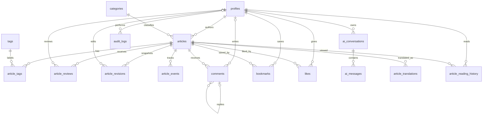

# Database

Supabase PostgreSQL is the source of truth. Apply migrations in timestamp order; migrations include starter category/tag rows, so no separate seed file is required.

## Migration order

1. [`20261124170000_roles_and_editorial_workflow.sql`](../supabase/migrations/20261124170000_roles_and_editorial_workflow.sql)
2. [`20261124233000_article_management.sql`](../supabase/migrations/20261124233000_article_management.sql)
3. [`20261125010000_community_pages.sql`](../supabase/migrations/20261125010000_community_pages.sql)
4. [`20261125020000_normalized_community_schema.sql`](../supabase/migrations/20261125020000_normalized_community_schema.sql)
5. [`20261125030000_search_discovery.sql`](../supabase/migrations/20261125030000_search_discovery.sql)

The normalization migration renames earlier tables and columns. Use the final names shown below in new application code.

## Relationships

- A profile can write many articles; an article can have no category or one category. Deleting a category clears the article's category reference.
- `article_tags` is a join table: it connects many articles with many tags without storing repeated tag names on each article.
- Reviews record editorial decisions and feedback. Revisions preserve numbered snapshots, and article events record workflow transitions.
- Comments can point to a parent comment to represent a reply. Deleting the parent removes its replies.
- Bookmarks and likes connect profiles to articles. A unique constraint on each user/article pair prevents duplicates.
- Each AI conversation belongs to one profile and contains separate messages. Article translations are stored separately by article, language, and style.
- Reading history is unique per profile/article pair. Audit logs retain the actor where available; `entity_id` is polymorphic and intentionally has no single-table foreign key.

## Access and indexes

RLS is enabled for user and community data. Public article reads are limited to published articles; profile data, editorial records, and AI conversations have narrower policies. The application also checks permissions on the server, but frontend checks alone are never sufficient.

Primary/foreign keys, unique constraints, state checks, and indexes are defined in the migrations. The search migration adds a generated `tsvector`, a partial GIN index for published articles, and a public-only RPC for full-text search, filters, sorting, and bounded pagination.

Apply and test the migrations in a development Supabase project before production. Verify the policies using anonymous, reader, contributor, editor, and owner accounts.
